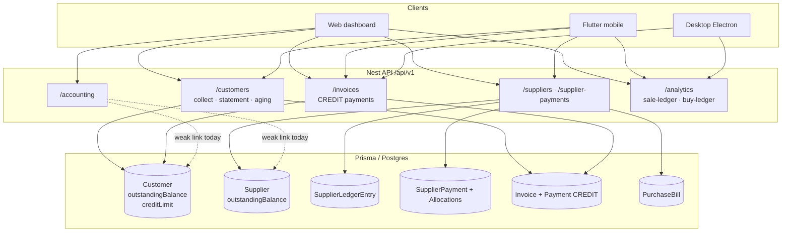
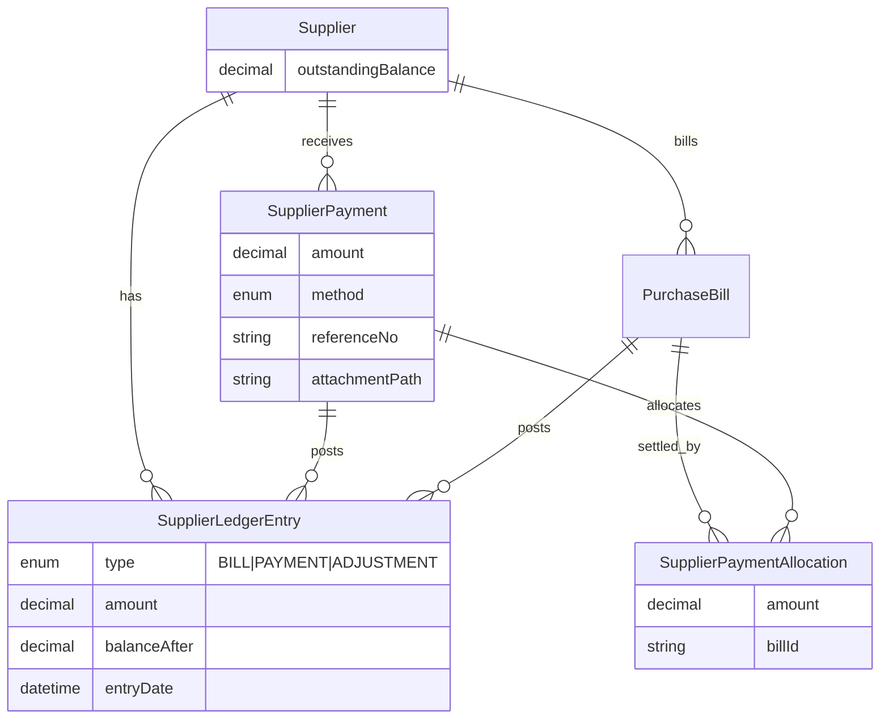
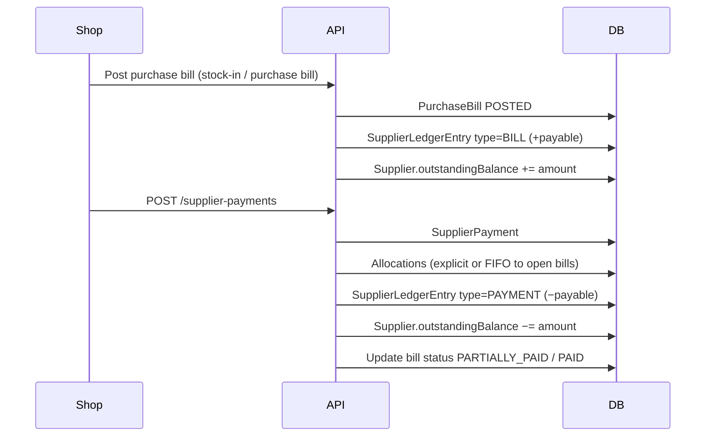
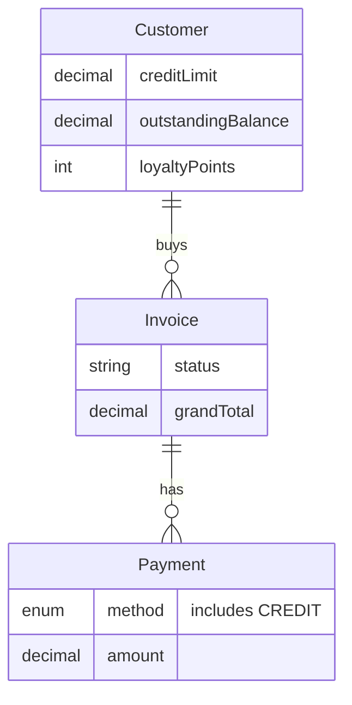
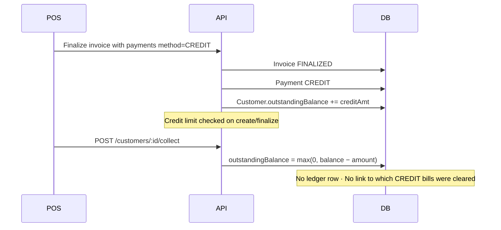
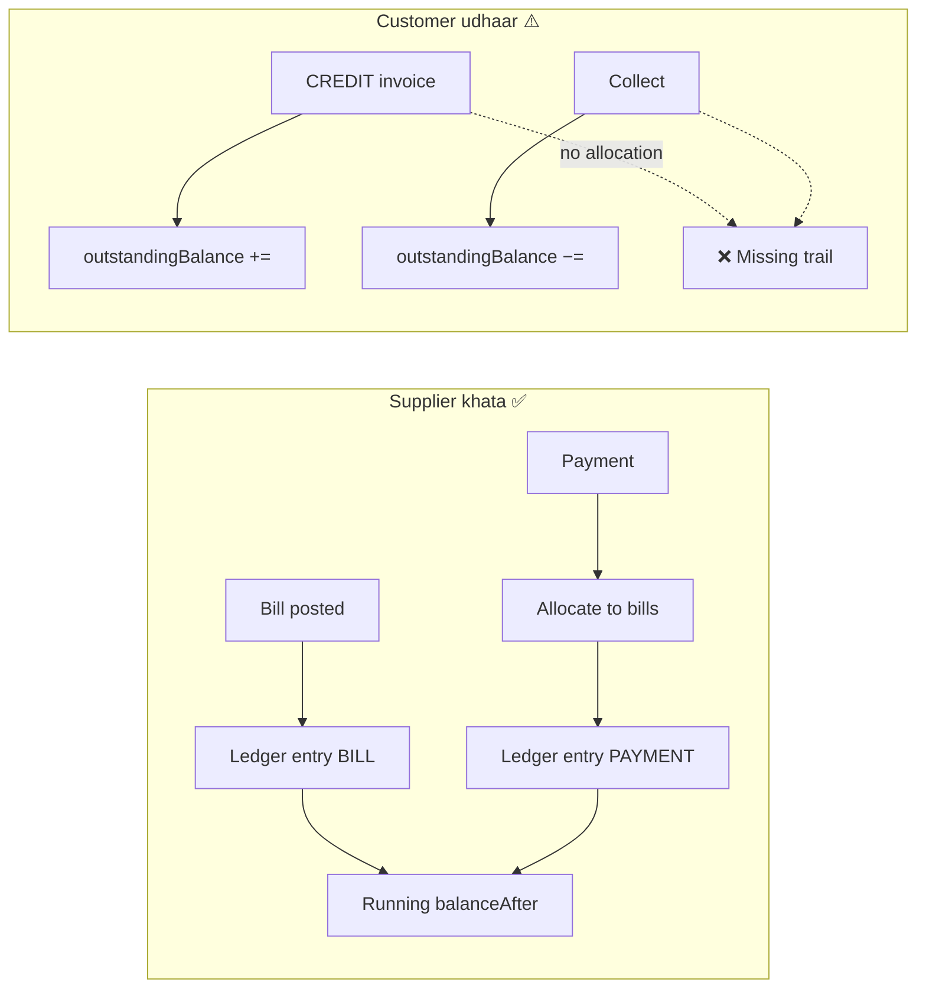
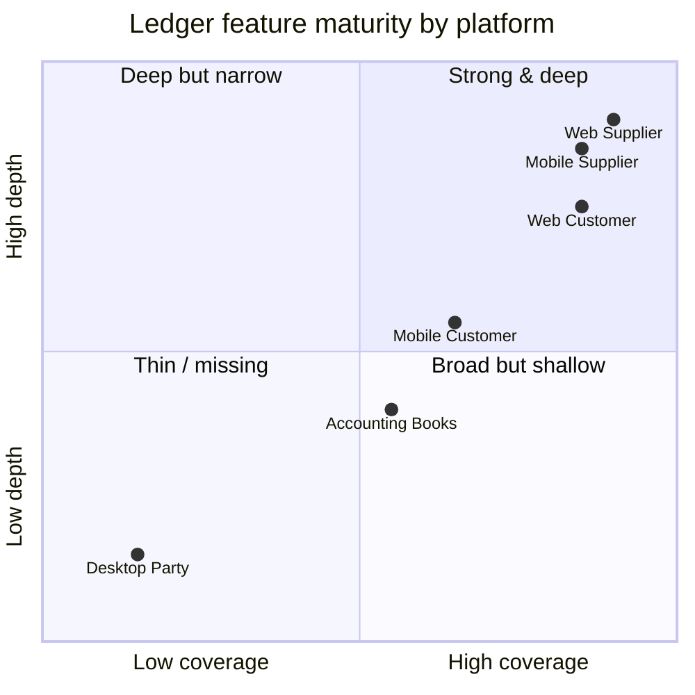
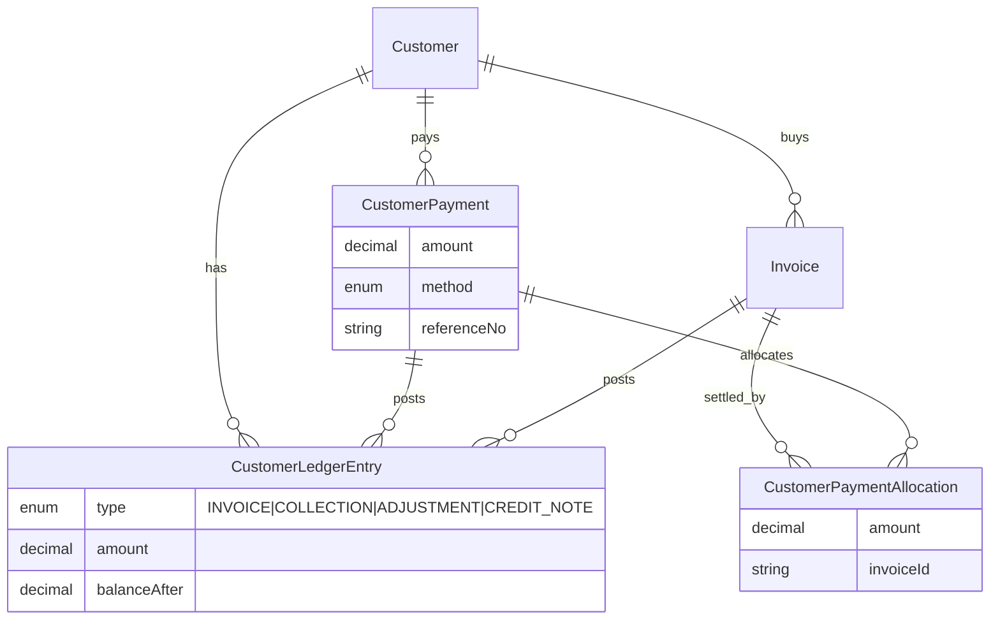
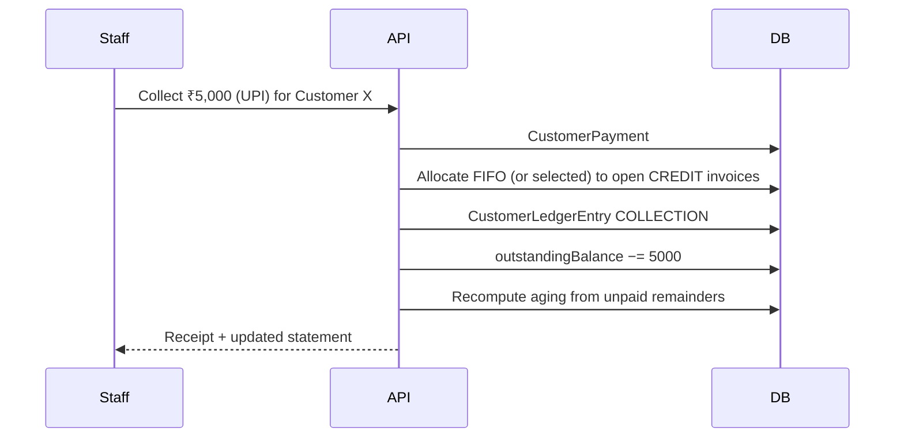
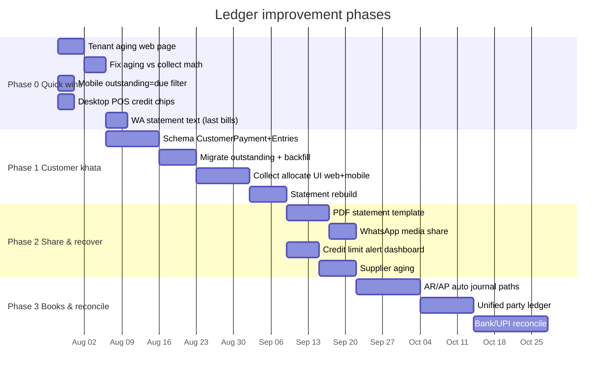

# Party Ledgers — Product Deep Dive

**RetailSarathi** · Customer udhaar (receivables) & supplier khata (payables)

This document explains how ledgers work today, where they fall short for Indian retail (batteries / electronics / wholesale-ish credit), and a phased plan to improve them.

---

## 0. Research (market demand)

Indian retail / wholesale-ish shops (batteries, mobiles, electronics, general trade) run **party khata**, not “CRM contact lists.” Daily questions are cash-flow questions:

| Shop need | Why it matters | Competitive bar (Vyapar / BUSY / Marg / Tally-ish) | RetailSarathi |
|-----------|----------------|-----------------------------------------------------|---------------|
| **Who we owe** | Morning cash plan; avoid surprise supplier calls | Shop-wide **payables board**, sorted by ₹ due | **Live** — `/dashboard/suppliers` + mobile aging board |
| **How old** | MSME / credit discipline; which bills to clear first | Aging buckets (0–30 / 31–60 / 61–90 / 90+) | **Live** — list mix + per-bill badges + `GET /suppliers/aging/report` |
| **Bill-by-bill settle** | “Pay this invoice, leave that one open” | Explicit allocation (not only FIFO / lump balance) | **Live** — FIFO **or** Pick bills (`allocationsJson`) |
| **Cheque / UTR attach** | Proof for disputes & bank reconcile | Ref # + photo/PDF on payment | **Live** — cheque/UTR fields + attachment on supplier (and customer) payments |
| **Statement share** | WhatsApp is the office printer | Party statement PDF / text ready to send | **Live** — Reports statement + WA text + HTML media |
| **Bank details** | NEFT/RTGS without hunting diaries | IFSC / A/c on party master | **Live** — supplier bank fields on create/edit |

**Positioning takeaway:** Competitors win on **payables board + aging + allocation** — not on a “supplier name list.” A directory of vendors with phone numbers is table stakes; the product is **dues visibility and settlement workflow**.

Same mental model applies to **customer udhaar** (who owes *us*): receivables board, aging, allocate collect, statement share. Supplier khata was the harder daily pain for stock-heavy shops; AR should feel identical.

**Out of scope for “market parity” today (still useful later):** production multi-FIU AA credentials beyond mock/consent+feed; Electron offline-first full ledger edit (desktop Khata board + web deep-link ships).

**Stock/compliance slice (shipped 2026-07-26):** mobile scan-to-count → partial GRN draft bill → ABC cycle counts → variance approval → purchase register/2B → MSME 45-day → variants/batch → BT RFCOMM print → AA consent flow → unified party search → cron reminders → desktop Khata. See [`UPGRADE_PLAN_BILLING_STOCK_CRM.md`](./UPGRADE_PLAN_BILLING_STOCK_CRM.md) §7.

---

## 1. What “ledger” means in this product

RetailSarathi has **three different “ledger-like” concepts**. They are easy to confuse:

| Concept | Purpose | Is it a true party khata? |
|---------|---------|---------------------------|
| **Customer udhaar** | Money customers owe the shop after CREDIT bills | **Yes** — ledger entries + collect allocations + aging (parity with supplier model) |
| **Supplier ledger** | Money the shop owes suppliers | **Yes** — running entries + payments + bill allocation |
| **Sale / buy ledger (analytics)** | Period sales/purchase reports | No — charts/reports, not party accounts |
| **Accounting books** | Chart of accounts, journal, P&L | Linked when auto-post toggles on — collections & supplier payments |

For shop owners, “ledger” usually means **party khata**: who owes whom, what bills are open, what was paid, and aging.

---

## 2. Current architecture (high level)

---

## 3. Supplier ledger (production-grade)

### 3.1 Data model

### 3.2 Lifecycle

### 3.3 Where it lives in the apps

| Surface | Path / screen | Capabilities |
|---------|---------------|--------------|
| Web | `/dashboard/suppliers`, `/dashboard/suppliers/[id]` | List, pending payable, record payment (cheque attach), ledger table, bills & payments |
| Mobile | `suppliers_ledger_screen.dart` | Strong parity: list → detail → ledger → pay with attachment |
| Desktop | — | Not available |
| API | `GET /suppliers/:id`, `POST /supplier-payments` | Full |

**Strengths:** running balance, payment methods, attachments, FIFO **and bill-by-bill allocation UI**, web + mobile, due dates, CGST/SGST/IGST on bills, aging buckets + shop-wide payables board (`GET /suppliers/aging/report`), pending ₹ on supplier list, bank master fields, statement PDF/Excel from Reports, WhatsApp dues share from supplier detail, duplicate purchase invoice guard on stock-in.

**Gaps:** GSTR-2B / ITC match not shipped; auto payment reminders (scheduled) not shipped; desktop party khata still missing.

---

## 4. Customer udhaar (usable but thin)

### 4.1 Data model (today)

There is **no** `CustomerLedgerEntry` and **no** `CustomerPaymentAllocation`. Collect only mutates `outstandingBalance`.

### 4.2 Lifecycle (today)

### 4.3 Aging (API exists)

`GET /customers/aging/report` (optional `?customerId=`) returns buckets:

| Bucket | Meaning |
|--------|---------|
| 0–30 days | Recent credit |
| 31–60 | Warm |
| 61–90 | Aging |
| 90+ | Overdue / recovery priority |

**Caveat:** aging is derived from CREDIT invoice amounts/dates. After `collect`, outstanding goes down but buckets may still show full original credit unless logic is fixed — so aging can disagree with the balance chip.

### 4.4 Where it lives in the apps

| Capability | Web | Mobile | Desktop |
|------------|-----|--------|---------|
| Customer list + outstanding | Yes (+ filters) | List + udhaar chip | No |
| Collect payment | Yes (detail) | Yes (sheet) | No |
| Per-customer aging | Yes (Udhaar tab) | No | No |
| Statement (invoice list) | Yes | No | No |
| WhatsApp reminder | Yes (if opt-in / link) | Call/WA to phone | No |
| Credit limit at POS | Shown + enforced | Shown | Method only |
| Shop-wide aging board | **API only** | No | No |
| PDF party statement | No | No | No |

Key web screens:

- `/dashboard/customers`
- `/dashboard/customers/[id]` — tabs: Profile / Udhaar / Bills / Repairs
- POS — credit left + outstanding chips

Key API:

- `GET /customers`
- `GET /customers/:id/statement`
- `GET /customers/aging/report`
- `POST /customers/:id/collect`

---

## 5. Side-by-side: supplier vs customer

| Capability | Supplier | Customer |
|------------|----------|----------|
| Running ledger entries | Yes | Yes — `CustomerLedgerEntry` |
| Payment record entity | `SupplierPayment` | `CustomerPayment` |
| Allocate to open docs | Yes — FIFO + pick bills | Yes — FIFO + pick invoices |
| Attachment / cheque scan | Yes | Method CHEQUE (attach optional later) |
| Aging report | Payables board + dues calendar | **Receivables board** on Customers |
| Statement PDF | Reports HTML print + receipt | Reports customer ledger HTML |
| WhatsApp | Dues + reminder log + bulk overdue | Reminder log via API |
| Payment trust | Void / bounce / realloc / receipt | Void collection |
| Advances / TDS / notes | Advance, TDS, debit/credit notes | Over-collect → advance |
| Bank reconcile | CSV match to payments | CSV match to collections |

Shops now share **one khata mental model** on both sides (web + mobile boards). Accounting auto-post links collections/payables into Cash/AR/AP when enabled.

---

## 6. Platform parity map

---

## 7. Related but different: analytics & accounting

### Sale / buy ledger (analytics)

- `GET /analytics/sale-ledger?days=`
- `GET /analytics/buy-ledger?days=`
- Mobile Reports screen has both; web analytics leans on sale-ledger.

These answer “how much did we sell/buy this month?” — **not** “how much does Ramesh still owe?”

### Accounting module

- Accounts (incl. seeded **1100 AR**, **2000 AP**), journal, P&L, balance sheet, ITR prep / Tally export.
- Today, auto-post paths for sales largely ignore credit (do not consistently Dr AR / Cr Sales, or Cr AP on purchase bills).
- Ledger maintenance toggles live under Settings (auto-post sales/credit notes, seed accounts) via GST engine `LedgerSettings`.

Until AR/AP journals follow retail credit, **books ≠ shop khata**.

---

## 8. Problems this causes for shops

1. **Cannot prove collections** — no receipt trail in customer ledger; only a smaller number on the profile.
2. **Aging loses trust** after partial collections — recovery calls may chase the wrong amount.
3. **Cannot settle oldest bills first** for customers (suppliers already can via FIFO).
4. **Mobile counter staff** can collect but cannot see aging / statement without web.
5. **Desktop POS** can take CREDIT without strong outstanding/limit UX.
6. **No shareable party statement** for B2B / dealer credit (common in battery wholesale).

---

## 9. Target customer ledger (recommended)

Mirror the supplier pattern:

### Target collect flow

---

## 10. Product improvements (ranked)

### Tier A — highest impact for Indian retail

| # | Idea | Why it matters |
|---|------|----------------|
| 1 | **Customer ledger + invoice allocation** | True khata; aging becomes correct; auditor-friendly |
| 2 | **Shop-wide receivables aging board** | Morning recovery workflow (API already exists) |
| 3 | **PDF + WhatsApp party statement** | Dealers ask for “mera hisab”; date range + opening/closing |
| 4 | **Credit limit alerts** | Over-limit list; soft vs hard block at POS |
| 5 | **Fix aging after collect** | Even before full ledger model, stop wrong 90+ numbers |

### Tier B — strong follow-ons

| # | Idea | Why |
|---|------|-----|
| 6 | Date filters + CSV/PDF export on both ledgers | CA / month-end |
| 7 | Supplier aging + due dates | Cheque cycles with distributors |
| 8 | Collect receipt print / slip | Counter trust |
| 9 | Desktop POS outstanding + credit left | Parity with web/mobile |
| 10 | Mobile customer 360 (aging + statement) | Counter recovery without laptop |

### Tier C — larger platform

| # | Idea | Why |
|---|------|-----|
| 11 | Unified party search (same GSTIN/phone as buyer & seller) | B2B dual roles |
| 12 | Bank/UPI UTR reconcile to collections | Finance hygiene |
| 13 | True AR/AP journal auto-post | Books match khata |
| 14 | Payment scheduling / reminders automation | Proactive recovery |

---

## 11. Phased roadmap

### Phase 0 — Quick wins (days)

- ~~Web Receivables aging~~ **Done** — board on `/dashboard/customers`
- ~~Correct aging after collect~~ **Done** (allocations)
- ~~Mobile customers outstanding filter~~ (existing) + receivables board
- Desktop POS outstanding chips (existing)
- ~~WhatsApp reminders with log~~ **Done** (supplier + customer)

### Phase 1 — Customer khata parity (weeks)

- ~~Schema CustomerPayment+Entries~~ **Done**
- ~~Collect allocate UI web+mobile~~ **Done** (FIFO + pick invoices on web)
- ~~Statement rebuild~~ **Done** (ledger + payments on statement/detail)

### Phase 2 — Share & recover

- ~~Branded HTML statement / receipt~~ **Done** (print-to-PDF)
- ~~WhatsApp text + log~~ **Done** (media upload deferred)
- Credit-limit alerts dashboard — partial (at-risk on detail)
- ~~Supplier aging / reminders~~ **Done**

### Phase 3 — Finance depth

- Accounting auto-post — **Done** — collections + supplier payments (Settings toggles)
- Unified party search — **deferred**
- ~~Bank/UPI CSV reconcile~~ **Done** — `/dashboard/bank-reconcile` + **feed sync** (`bankFeedUrl` / `BANK_FEED_URL`)
- WhatsApp media — **Done** — HTML document + optional `WHATSAPP_API_URL` mediaUrl

---

## 12. Suggested screen inventory (future)

| Screen | Platform | Notes |
|--------|----------|-------|
| Receivables aging board | Web (then mobile) | Buckets, sort 90+, WA/call |
| Customer ledger detail | Web + mobile | Entries + open invoices + collect |
| Statement PDF preview | Web + mobile | Print / share |
| Payables aging | Web + mobile list | **Live** — `/dashboard/suppliers` board + purchase-bills filters |
| Credit risk list | Web | Over limit / near limit |
| Unified party search | Web | Optional Phase 3 |

---

## 13. API cheat sheet (today)

### Customers / udhaar

| Method | Path | Role |
|--------|------|------|
| `GET` | `/customers` | List; `outstanding=due\|clear`, search, segment |
| `GET` | `/customers/:id` | Profile |
| `GET` | `/customers/:id/statement` | Recent invoices + optional WA URL |
| `GET` | `/customers/aging/report` | Tenant or one customer aging |
| `POST` | `/customers/:id/collect` | Collect + FIFO or pick-invoice allocations |
| `POST` | `/customers/:id/reminders` | Log WA reminder + waUrl |
| `GET` | `/customers/:id/open-invoices` | Open CREDIT invoices with due |
| `POST` | `/customers/payments/:id/void` | Void a collection |

### Suppliers / payables

| Method | Path | Role |
|--------|------|------|
| `GET` | `/suppliers` | List + pending summary |
| `GET` | `/suppliers/aging/report` | Shop-wide payables by supplier + buckets |
| `GET` | `/suppliers/dues-calendar` | Bills due in date range (pay this week) |
| `GET` | `/suppliers/:id` | Bills, payments, ledger, reminders, summary |
| `POST` | `/suppliers/:id/reminders` | Log WA dues reminder + return waUrl |
| `POST` | `/suppliers/reminders/bulk-overdue` | Log + return WA links for overdue suppliers |
| `POST` | `/suppliers/:id/apply-advance` | Apply advanceBalance to open bills |
| `POST` | `/suppliers/:id/adjustments` | DEBIT_NOTE / CREDIT_NOTE |
| `POST` | `/supplier-payments` | Pay + TDS + allocationsJson / FIFO |
| `POST` | `/supplier-payments/:id/void` | Reverse allocations + reopen bills |
| `POST` | `/supplier-payments/:id/bounce` | Cheque bounce reopen |
| `PATCH` | `/supplier-payments/:id/allocations` | Reallocate posted payment |
| `GET` | `/supplier-payments/:id/receipt` | Receipt JSON + print HTML |

### Bank reconcile

| Method | Path | Role |
|--------|------|------|
| `POST` | `/bank-statements/import` | CSV import |
| `GET` | `/bank-statements` | List unmatched/matched |
| `GET` | `/bank-statements/:id/suggest` | Suggest payment matches |
| `POST` | `/bank-statements/:id/match` | Link to supplier/customer payment |
| `POST` | `/bank-statements/:id/ignore` | Ignore line |

### Analytics (not party khata)

| Method | Path |
|--------|------|
| `GET` | `/analytics/sale-ledger` |
| `GET` | `/analytics/buy-ledger` |

---

## 14. Success metrics

After Phase 1–2, a shop should be able to:

1. See **who owes money** and **how old** the debt is in under 10 seconds.
2. Collect money and see **which bills** were cleared.
3. Share a **statement** on WhatsApp that matches the on-screen balance.
4. Block or warn at POS when **credit limit** is exceeded (already partly true).
5. Treat **customer and supplier khata** with the same mental model.

---

## 15. Bottom line

- **Supplier ledger** is best-of-class for daily payables: reminders + log, void/bounce/realloc, TDS/advance/notes, mobile aging board, payment receipt HTML, bank CSV/feed match.
- **Customer udhaar** mirrors that model: ledger entries, collections with FIFO/pick-invoice allocate, receivables board, reminder log, statement HTML + WhatsApp media.
- **Accounting auto-post** now covers collections (Dr Cash · Cr AR) and supplier payments (Dr AP · Cr Cash), toggles in Settings.
- **Bank feed sync** via `ledgerSettings.bankFeedUrl` / `BANK_FEED_URL` + auto-match (not a full AA aggregator).
- **WhatsApp media**: HTML receipt/statement saved under `/uploads/whatsapp` and sent when `WHATSAPP_API_URL` accepts `mediaUrl`.

---

## Related docs

- [`UPGRADE_PLAN_BILLING_STOCK_CRM.md`](./UPGRADE_PLAN_BILLING_STOCK_CRM.md) — broader CRM/billing (may be partly outdated on aging)
- [`MVP_SCOPE.md`](./MVP_SCOPE.md) — original MVP boundaries
- Schema: `apps/api/prisma/schema.prisma` — `Customer`, `Supplier`, ledger/payment models, `PartyReminderLog`, `BankStatementLine`

---

*Last updated: 2026-07-26*
