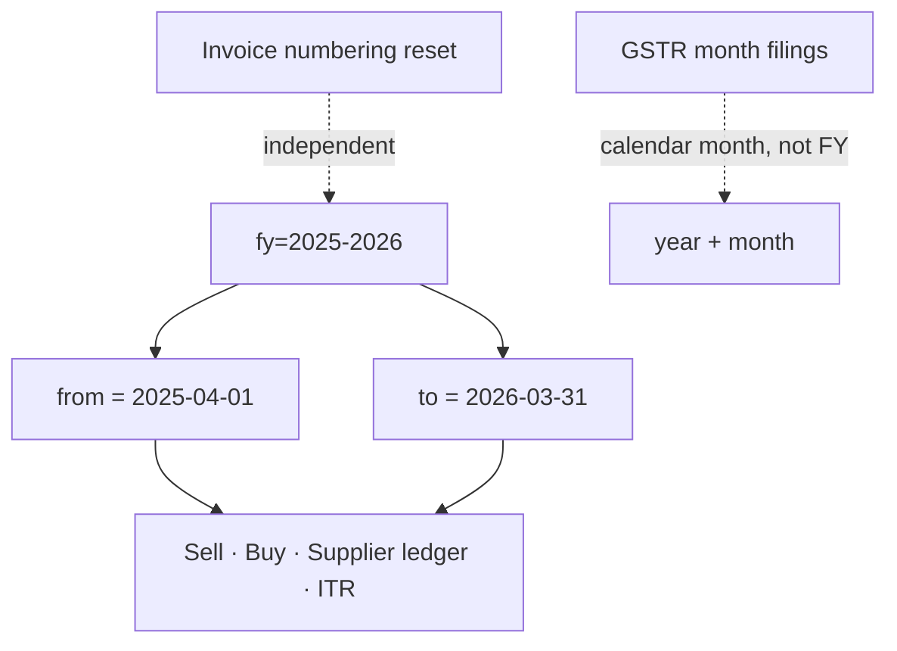

# Reports & FY Product Spec

> **Status (implemented):** Phase 1–3 shipped — `GET /reports/sell|buy|supplier-ledger/:id|customer-ledger/:id|rollups|itr-pack` with `from`/`to`/`fy`/`quarter`/`days` and `format=json|csv|xlsx|pdf`. Web hub at `/dashboard/reports` includes **Q1–Q4** presets and an **ITR pack** tab (sell+buy+quarters + CSV/Excel/PDF + Tally). Accounting ITR links into the pack.

What shops need for **weekly / monthly sell & buy registers**, **per-supplier ledger**, **FY-by-FY control**, and **PDF / CSV / Excel** export — mapped against what RetailSarathi has today.

Related: [LEDGER_PRODUCT.md](./LEDGER_PRODUCT.md) (party khata / AR–AP).

---

## 1. Goal (shop language)

| Need | Meaning |
|------|---------|
| Weekly / monthly reports | Period totals + line register for a week or month |
| Sell report | Only **valid (FINALIZED)** sales invoices, with **customer** details |
| Buy report | Purchase register with **supplier** details (not stock-movement estimates) |
| Supplier ledger | Separate khata per supplier (opening → bills → payments → closing) |
| FY by FY | Every report can be scoped to Indian financial year (Apr–Mar) |
| Export | Same data as **PDF**, **CSV**, and **Excel (XLSX)** |

---

## 2. What exists today

```mermaid
flowchart LR
  subgraph Have["Already built"]
    SL["Sale ledger<br/>FINALIZED · days · cap 100"]
    BL["Buy ledger<br/>Stock PURCHASE lines · no supplier"]
    M["Monthly sales buckets<br/>calendar months"]
    SUP["Per-supplier ledger<br/>web + mobile"]
    FYN["Invoice # resets by FY"]
    ITR["ITR / Tally by FY"]
    GST["GSTR-1 / 3B by month"]
  end

  subgraph Missing["Missing for this goal"]
    WK["Weekly buckets"]
    FYR["FY filter on sell/buy reports"]
    BUY["Purchase-bill buy report"]
    EXP["PDF / CSV / XLSX period export"]
    DET["GSTIN / address on sell rows"]
  end

  Have --> Missing
```



| Area | Status | Notes |
|------|--------|--------|
| Valid invoices only | ✅ | Analytics / GST / ITR use `FINALIZED` only |
| Sale ledger | ⚠️ | `GET /analytics/sale-ledger?days=` — name + phone; **days only**; **take 100** |
| Monthly sales | ⚠️ | Calendar months, not FY months; sell only |
| Weekly reports | ❌ | No week buckets / presets |
| Buy report (supplier bills) | ❌ | Current “buy ledger” = stock movements, no supplier |
| Purchase bills list | ✅ | Filters exist; not a period report + export |
| Per-supplier ledger | ✅ | Strong (see ledger doc); no date/FY filter or export |
| FY numbering | ✅ | `{PREFIX}-{FY}-{SEQ}` via gst-engine |
| FY on analytics | ❌ | No `fy=` on sell/buy reports |
| Period PDF/CSV/XLSX | ❌ | Only product CSV, ITR CSV/Tally, per-invoice print |

---

## 3. Recommended report suite

### 3.1 Sell report (sales register)

**Source:** `Invoice` where `status = FINALIZED` (exclude DRAFT / CANCELLED). Credit notes shown as negative or separate type filter.

**Period presets**

| Preset | Range |
|--------|--------|
| This week / Last week | Mon–Sun (configurable) |
| This month / Last month | Calendar month |
| This FY / Last FY | 1 Apr → 31 Mar |
| Custom | `from` / `to` |

**Summary strip**

- Invoice count · Gross sales · Returns · Net sales  
- Taxable · CGST · SGST · IGST · Grand total  
- Payment mix (Cash / UPI / Card / Credit / Mixed)

**Detail columns**

| Column | Why |
|--------|-----|
| Date | Period sorting |
| Invoice # | FY series already |
| Type | TAX_INVOICE / CREDIT_NOTE |
| Customer name | Required |
| Phone | Required |
| GSTIN | B2B / GST |
| State / place of supply | GST |
| Taxable / tax / grand total | Books |
| Payment methods | Day-end cash |
| Sold by · Branch | Staff / multi-branch |

**API shape (proposed)**

```
GET /reports/sell?from=&to=&fy=&branchId=&paymentMethod=&format=json|csv|xlsx|pdf
```

Build on `getSaleLedger`: add `from`/`to`/`fy`, raise/remove `take: 100` for export, add customer GSTIN/state.

---

### 3.2 Buy report (purchase register)

**Source:** `PurchaseBill` — statuses **POSTED / PARTIALLY_PAID / PAID** (exclude CANCELLED; optionally exclude DRAFT).

Do **not** use current stock-based `buy-ledger` as the main “buy report” (it has no supplier and uses estimated `purchasePrice`). Keep stock ledger as a separate **“Stock in”** view if useful.

**Summary strip**

- Bill count · Subtotal · Tax · Total · Paid · Payable remaining · By supplier

**Detail columns**

| Column | Why |
|--------|-----|
| Bill / invoice date | Period |
| Supplier invoice # | Match physical bill |
| Supplier name · Phone · GSTIN | Party |
| Subtotal · Tax · Total | Books |
| Paid · Balance · Status | AP |
| Created by | Staff accountability |

**Optional 2nd Excel sheet:** line items (SKU, qty, rate, HSN, GST%).

**API shape (proposed)**

```
GET /reports/buy?from=&to=&fy=&supplierId=&status=&format=json|csv|xlsx|pdf
```

---

### 3.3 Supplier ledger (per party, FY-aware)

Already strong operationally. Add:

| Feature | Detail |
|---------|--------|
| Period | `from` / `to` / `fy` with **opening balance** as of `from` |
| Statement PDF | Header (shop + supplier), opening, rows, closing — WhatsApp-ready |
| CSV / Excel | Same rows for CA |
| Aging | 0–30 / 31–60 / 61–90 / 90+ on open bills |

**API shape (proposed)**

```
GET /reports/supplier-ledger/:supplierId?from=&to=&fy=&format=json|csv|xlsx|pdf
```

Later: **customer ledger** parity (see LEDGER_PRODUCT.md) for sell-side udhaar statements.

---

## 4. Financial year model (India)

Reuse `getIndianFinancialYear` / period helpers in `packages/gst-engine` (Apr 1 – Mar 31).



**Rules**

1. Every period report accepts **`fy=` OR `from`+`to`** (FY expands to dates).
2. Default UI picker: **current Indian FY** (fix accounting page bug that uses calendar year in Jan–Mar).
3. GST stays **month-based**; FY reports are for owner / CA / books.
4. **FY lock / closing** (no edits in closed year, opening balances) is Phase 2 — do not block report filters on it.

---

## 5. Export matrix

| Report | JSON (UI) | CSV | Excel | PDF |
|--------|-----------|-----|-------|-----|
| Sell register | ✅ | ✅ | ✅ summary + rows | ✅ summary + table |
| Buy register | ✅ | ✅ | ✅ + optional lines sheet | ✅ |
| Supplier ledger | ✅ | ✅ | ✅ | ✅ statement |
| Weekly / monthly rollup | ✅ | ✅ | ✅ one sheet per period | ✅ short summary |

**Tech (already in monorepo)**

| Format | Approach |
|--------|----------|
| CSV | Same pattern as products / ITR string builders |
| Excel | API already has `xlsx` (used for import) — use for **write** |
| PDF | Start with HTML print template (like invoices); add server PDF later if needed |
| Mobile | Reuse `pdf` / `printing` for share |

Shared util suggestion: `apps/api/src/reports/report-export.util.ts` (csv / workbook / html).

---

## 6. Improvements & other features worth adding

### Must-have with the suite above

1. **Unified Reports hub** (web + mobile): Sell | Buy | Supplier ledgers | Period presets | Export buttons.  
2. **Remove / raise 100-row caps** on export paths (stream or paginate UI; full data for files).  
3. **Rename** stock “buy ledger” → “Stock in movements” so it is not confused with supplier bills.  
4. **Fix FY picker** on accounting page for Jan–Mar.  
5. **Credit notes** clearly separated or signed negative on sell report.

### High-value extras

| Feature | Why |
|---------|-----|
| Payment-method day/week cash report | Closing counter |
| Branch filter on all reports | Multi-branch shops |
| Staff / sold-by filter | Commission & accountability |
| Customer outstanding aging board | Mirror supplier AP (API exists) |
| Customer ledger + statement PDF | B2B credit sales |
| GSTIN-wise B2B sell register | CA / GSTR cross-check |
| HSN summary for period | GSTR-1 support |
| Compare this month vs last / this FY vs last | Owner dashboard |
| Scheduled email (weekly PDF to owner) | Later |

### Explicitly out of scope for v1

- Full FY closing / period lock  
- Bank UTR auto-reconcile  
- Replacing GSTR JSON with Excel portal format (nice later)

---

## 7. Build phases

### Phase 1 — Quick wins (~1–2 weeks)

1. `from` / `to` / `fy` on sale ledger + purchase-bill report endpoint.  
2. Week / month / FY presets in UI (mobile chips + web date bar).  
3. Enrich sell rows: GSTIN, state.  
4. Buy report from `PurchaseBill` (not stock ledger).  
5. CSV + XLSX export on sell, buy, supplier ledger.  
6. Fix accounting FY calculation.

### Phase 2 — Statements & PDF

1. HTML/PDF templates for sell / buy / supplier statement.  
2. Opening/closing balance on supplier ledger by period.  
3. Supplier aging export.  
4. Web Reports page (table + export); mobile share files.

### Phase 3 — Parity & depth

1. Customer ledger + collect allocation (ledger doc Tier A).  
2. HSN / payment / branch rollups.  
3. FY compare + optional FY lock.  
4. Desktop export parity.

---

## 8. Acceptance checklist (v1)

- [ ] Sell report: FINALIZED only; customer name, phone, GSTIN; week/month/FY/custom  
- [ ] Buy report: purchase bills with supplier name/GSTIN; week/month/FY/custom  
- [ ] Each supplier has a period ledger with opening/closing  
- [ ] All three export PDF, CSV, and Excel  
- [ ] Switching FY changes numbers and export filenames (`Sell_FY2025-26.xlsx`)  
- [ ] Busy shops: export includes **all** rows in period (not capped at 100)

---

## 9. Bottom line

You already have the **hard parts** for books (FINALIZED analytics, real supplier khata, FY invoice series, ITR/GSTR). What’s missing for day-to-day shop reporting is a **period register product**: date/FY-capable **sell** and **purchase-bill buy** reports with full party fields, uncapped exports, and PDF/CSV/Excel — plus FY presets on the existing supplier ledger.
`}
