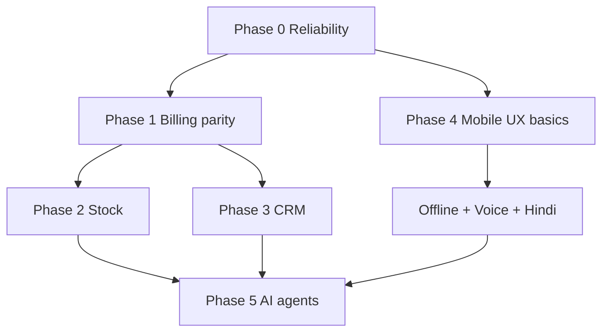
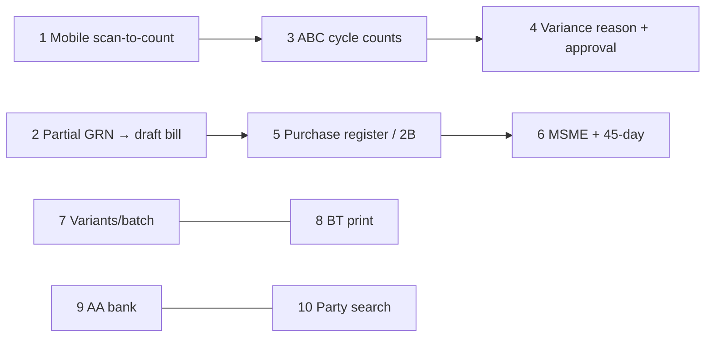

# RetailSarathi Upgrade Plan — Billing · Stock · CRM · Mobile · AI

**Date:** 2026-07-19  
**Scope:** Reliability & market parity across web, desktop, mobile  
**Verdict:** Solid online GST spine; **not yet market-grade** for concurrent multi-counter / offline shops.

---

## 1. Honest reliability assessment

| Mode | Shop-floor billing reliability | Why |
|------|-------------------------------|-----|
| **Web** | **6/10** | Best client today (GST, credit limit, wholesale, cancel). Gaps: hold, split pay, discounts UI, returns, real e-invoice, concurrent stock races |
| **Mobile** | **4/10** | Fast counter + camera/gun scan + PDF. Online-only; no wholesale/credit-limit parity; no offline |
| **Desktop** | **2–3/10** | Offline demo only; invoice sync to server **does not persist invoices**; thermal print is console stub |
| **Overall (all modes)** | **4/10** | Market tools (Vyapar / GoFrugal / RetailPOS class) win on offline, returns, thermal, udhaar, and safe multi-register stock |

### Compared to market (India 2026)

Market expectations researched from Indian retail POS buying guides (Retail POS 2026 checklist, Unipro chain guide, LogicERP, Kirana voice/offline apps, NASSCOM AI-POS trends):

| Must-have | Market | RetailSarathi today |
|-----------|--------|---------------------|
| GST auto from HSN | Required | Yes (gst-engine) |
| Offline billing + sync | Required | Desktop incomplete; mobile/web no |
| Concurrent stock safety | Required | **No** server stock guard |
| Hold / recall bill | Standard | Missing |
| Split payment | Standard | API schema only; UI single pay |
| Returns / credit notes | Standard | Cancel only (full bill) |
| Thermal ESC/POS | Standard | Stub / browser / PDF |
| Serial/IMEI at sale | Electronics | Schema; not enforced on sale |
| Udhaar ledger + aging | Indian retail | Balance field; no statement/aging |
| Real e-invoice IRN | Growing mandate | Demo IRN only |
| Branch stock on sale | Chains | BranchStock unused at billing |
| Loyalty at checkout | Common | Earn only; redeem not on POS |
| Voice / Hindi UX | Mobile Bharat | English UI; no voice |

---

## 2. Upgrade plan — phased

### Phase 0 — Reliability foundation (2–3 weeks) — **do first**

Without this, other features are unsafe.

1. **Server stock guard** — decrement only if `stockQty >= qty` (row lock / conditional update); reject oversell.
2. **Invoice number inside transaction** — atomic sequence per tenant.
3. **Payment integrity** — Σ payments must equal `grandTotal` (±1 paisa).
4. **Server credit-limit check** — reject CREDIT over limit (today web-only client check).
5. **Fix desktop sync** — `SyncService` must actually insert invoices from outbox; reconcile stock conflicts (last-write / vector clock / server-wins with conflict log).
6. **Cancel side-effects** — reverse loyalty earn + reverse/adjust accounting journal.
7. **Concurrency tests** — two POS clients same SKU; assert no negative stock / duplicate invoice numbers.

**Exit criteria:** Multi-register stress test passes; desktop offline sale appears on server.

---

### Phase 1 — Billing parity (3–4 weeks)

1. **Hold / recall bill** — save cart as `DRAFT` (or `HELD`); list “Held bills”; resume / discard.
2. **Draft → Finalize** — use existing `DRAFT` status; finalize endpoint.
3. **Split payment UI** — web + mobile; multiple methods summing to total.
4. **Line / bill discounts** — expose existing API discount fields in POS.
5. **Returns / credit notes** — partial return against original invoice; stock `RETURN`; credit note GST doc; link to original.
6. **Thermal ESC/POS** — Bluetooth/USB via mobile + desktop (existing text template → real printer); web: download `.bin` / QZ Tray optional.
7. **Serial/IMEI pick at sale** — when `trackSerial`, require IN_STOCK serials; mark `SOLD`.
8. **Platform parity matrix** — same billing rules on web and mobile (wholesale pricing, credit limit, discounts).

**Exit criteria:** Counter can hold, split pay, return 1 line, print thermal, sell IMEI item safely on web **and** mobile.

---

### Phase 2 — Stock management (3–4 weeks)

1. **Branch stock on sale** — decrement `BranchStock` for invoice branch; transfers already exist.
2. **Create transfer UI** (web) — today list/complete only.
3. **Purchase Order + GRN** — PO → receive → ledger PURCHASE; variance report.
4. **Stock take / cycle count** — session, counted qty, variance → ADJUSTMENT.
5. **Supplier master CRUD** — replace free-text only stock-in.
6. **Serial receive on stock-in** — create `ProductSerial` rows on purchase/OCR confirm.
7. **Optional (domain):** variants matrix **or** batch/expiry — pick by vertical (electronics → serials first; FMCG later).
8. **Mobile stock-in** — camera scan + qty adjust; CSV import stays web (large files).

**Exit criteria:** Branch A sale doesn’t steal Branch B stock; GRN + stock take used in a pilot week.

---

### Phase 3 — Customer / CRM (2–3 weeks)

1. **Customer 360 page** — purchase history, repairs, loyalty, outstanding (API already has detail).
2. **Udhaar / khata** — payment collection against outstanding; aging 30/60/90; statement PDF/WhatsApp.
3. **Loyalty at POS** — redeem points at checkout; show earn preview.
4. **WhatsApp bill** — auto-send invoice PDF/link on finalize (opt-in).
5. **Tags + whatsappOptIn** in UI; DND respect.
6. **Mobile CRM lite** — search by phone, add customer, view outstanding, collect payment.
7. **Credit reminders** — scheduled SMS/WhatsApp for overdue.

**Exit criteria:** Dealer can see statement, pay udhaar, redeem loyalty on a bill, get WhatsApp invoice.

---

### Phase 4 — Mobile “anyone can use” (ongoing, parallel from Phase 1)

Design principles (Bharat / kirana UX research): large thumb targets, one primary action, Hindi/Hinglish, voice where typing hurts, offline-first.

1. **Simplified home** — 3 huge buttons: **Bill · Stock · Customers** (hide advanced in More).
2. **One-hand POS** — bottom cart dock; scanner field always focused; big ₹ checkout.
3. **Hindi (hi-IN) + English** — Flutter `intl` / ARB; start with POS + stock adjust strings.
4. **Voice assist (Phase 4b)** — “Exide battery ek” / Hinglish → cart add (on-device or cloud STT).
5. **Offline mobile billing** — local DB + outbox (reuse desktop patterns, fixed sync).
6. **Guided empty states** — first bill wizard; demo scan codes.
7. **Role modes** — Cashier (bill only) vs Owner (reports/settings).
8. **Accessibility** — 48dp targets, high contrast outdoor mode, large currency fonts.

**Exit criteria:** New cashier bills without training in &lt;5 minutes; works on mid-range Android offline for N hours.

---

### Phase 5 — AI automation (realtime) — after Phases 0–2

Build on existing rule AI (`/ai/reorder`, forecast, duplicate IMEI, OCR hints) → agentic layer.

| Layer | Capability |
|-------|------------|
| **Assist** | Chat: “kitna stock Exide?”; voice bill line parse |
| **Suggest** | Reorder PO draft from velocity; dead stock; price anomaly |
| **Act (human approve)** | Auto-create PO; WhatsApp low-stock to supplier; hold suspicious IMEI |
| **Realtime** | Stream low-stock / credit-limit alerts to mobile; optional WebSocket |
| **Vision** | Invoice photo → stock-in lines (upgrade OCR); shelf photo later |
| **Architecture** | Offline-safe: on-device hints + cloud agents when online (NASSCOM India POS pattern) |

**Guardrails:** Never auto-finalize bill without confirm; never auto-post journal without audit log; credit actions need owner role.

---

## 3. Double-check — does this plan cover everything?

### Market checklist coverage

| Area | Covered in plan? | Phase |
|------|------------------|-------|
| GST HSN billing | Already strong; keep | — |
| Offline + sync | Yes | 0, 4 |
| Concurrent stock | Yes | 0 |
| Hold bill | Yes | 1 |
| Split payment | Yes | 1 |
| Discounts | Yes | 1 |
| Returns / credit notes | Yes | 1 |
| Thermal print | Yes | 1 |
| E-invoice (real IRP) | Deferred* | 1.5 / later |
| E-way bill | Deferred* | later |
| Serial/IMEI lifecycle | Yes | 1–2 |
| Multi-branch stock on sale | Yes | 2 |
| PO / GRN | Yes | 2 |
| Stock take | Yes | 2 |
| Supplier master | Yes | 2 |
| Variants / batch-expiry | Optional by vertical | 2 note |
| Customer 360 | Yes | 3 |
| Udhaar / aging | Yes | 3 |
| Loyalty at POS | Yes | 3 |
| WhatsApp automation | Yes | 3, 5 |
| Mobile simplicity / Hindi / voice | Yes | 4 |
| AI realtime automation | Yes | 5 |
| Desktop production parity | Via Phase 0 sync + Phase 1 print | 0–1 |
| GSTR-1/3B | Exists; keep improving | maintain |
| Accounting accuracy by payment method | Phase 0 cancel + method mapping | 0 |

\* **E-invoice / e-way:** plan includes *demo → real GSP* as **Phase 1.5** once billing integrity is solid (IRP credentials, NIC compliance). Not skipped—sequenced after core POS reliability.

### Explicitly out of scope (for now)

- Full ERP (HR, payroll)
- Quick-commerce 10-min delivery orchestration
- Multi-country tax

---

## 4. Suggested sequencing (roadmap)

**Priority for your shop type (battery / inverter / electronics):**  
Phase 0 → Phase 1 (IMEI + thermal + hold + returns) → Phase 4 mobile → Phase 2 serial receive + branch → Phase 3 udhaar → Phase 5 AI.

---

## 5. Success metrics

| Metric | Target |
|--------|--------|
| Oversell incidents | 0 in pilot |
| Bill time (scan → print) | &lt; 30s median |
| Offline bill loss | 0 after sync |
| Cashier training time | &lt; 15 min |
| Stock accuracy vs physical count | ≥ 98% after stock-take cycle |
| WhatsApp invoice open rate | Tracked; opt-in ≥ 50% of bills |

---

## 6. Recommendation

You are right: **billing is not yet up to market mark** across all modes. The gap is less “no GST” and more **reliability + shop-floor workflows + offline + hardware + CRM depth**.

Execute **Phase 0 immediately** before adding AI automation—otherwise AI will accelerate broken stock and sync.

When you approve a phase, implementation can start with Phase 0 API stock guards + invoice sequence + sync fix.

---

## 7. Status update — 2026-07-25

**Shipped / live (stock + billing):** Phase 0–1 billing reliability; PO → GRN → purchase bill; stock take (OPEN/complete/cancel/BranchStock); purchase bill aging + tax split; stock-in drafts + enrichment; trade-in pipeline; **duplicate purchase invoice guard** (`GET /purchase-bills/check-invoice`, stock-in 409 unless `appendToExistingBill`).

### Still open vs market (honest backlog)

Core Phase 0–5 billing/stock/CRM is live. These are the remaining gaps that keep “full market parity” incomplete — not blockers for daily GST billing:

| Gap | Shop need | Competitive bar | RS today | Priority |
|-----|-----------|-----------------|----------|----------|
| **Variants / batch-expiry** | Size·colour matrix (apparel) or batch + expiry (FMCG/pharma) at sell & stock | Variant picker / FEFO at POS | **Live** — `trackBatch`, `ProductBatch`, `variantLabel` / `parentProductId` | — |
| **GSTR-2B / ITC** | Match purchase bills to 2B; claim ITC confidently; MSME aging flags | 2B import + bill match + mismatch queue | **Live** — `/dashboard/gstr2b` + purchase register | — |
| **Scan-to-count / ABC** | Barcode-gun count sessions; cycle-count A items more often; variance reasons | Guided count + ABC cycle plan | **Live** — scan API + ABC cycle + variance approve | — |
| **Native Bluetooth printer** | One-tap print from phone/desktop without saving a file | Pair BT/USB ESC/POS → print | **Live** — `POST /hardware/print-thermal` + MAC on HardwareConfig | — |
| **Deeper udhaar entry trail** | Every credit / collect / void as ledger rows + bill allocation (like supplier khata) | Party ledger + allocate collect | **Done** — `CustomerLedgerEntry` / allocations / receivables board | — |

Also still thin: deep multi-FIU production AA credentials (consent + feed/mock authorize ships); optional WhatsApp Cloud API for cron delivery without WHATSAPP_API_URL.

**Positioning:** Reliability + party khata + GST spine ship today. Variants, 2B, gun-count, and native print are **vertical / hardware add-ons** — ship when a pilot vertical demands them, not as generic MVP churn.

---

### Suggested roadmap (priority) — research complete

Build order for the **next** slice after Phase 0–5 core. Ordered by shop-floor pain × India compliance leverage (battery / electronics / wholesale-ish credit).

| # | Initiative | Why shops care | What “done” looks like | Depends on | Effort | Status |
|---|------------|----------------|------------------------|------------|--------|--------|
| **1** | **Mobile corrections + scan-to-count** | Floor staff live on phone; web-only count = dead stock accuracy | Mobile stock-take: barcode scan increments count, correction of wrong lines, same OPEN/complete rules as web | Existing stock-take API | M | **Live** |
| **2** | **Partial GRN → draft purchase bill** | Partial receive today can leave AP / bill blind spots vs physical stock | Receive N of M lines → **DRAFT** purchase bill (editable tax/HSN) → post when invoice arrives; unpaid remainder stays on PO | PO/GRN pipeline | M | **Live** |
| **3** | **Category / ABC cycle counts** | Counting everything weekly fails; A-items drive shrink | Cycle plan: A weekly / B monthly / C quarterly; filter stock-take by category or ABC grade from Analytics | ABC analytics (live) + stock take | S–M | **Live** |
| **4** | **Variance reason + approval** | Shrink without reason = no control | On complete: reason code per variance line; threshold → owner approve before ADJUSTMENT posts | Stock take complete | S | **Live** |
| **5** | **Purchase register / GSTR-2B view** | Generic POS stops at “purchase list”; GST shops need ITC confidence | Purchase register (period, GSTIN, taxable, tax) + optional 2B JSON/CSV import → match / mismatch queue | Purchase bills + tax split (live) | L | **Live** |
| **6** | **Supplier MSME + 45-day aging** | India compliance story (buyer payment discipline to MSME suppliers) | Supplier flag `isMsme`; board/report highlight dues **> 45 days**; optional reminder CTA | Supplier aging board (live) | S | **Live** |
| **7** | **Variants / batch-expiry** | Apparel matrix / FMCG lots | `parentProductId` + `variantLabel`; `ProductBatch` + FEFO + expiring list | Product master | M | **Live** |
| **8** | **Native BT printer** | One-tap ESC/POS | `POST /hardware/print-thermal` + Flutter RFCOMM write + Electron COM/`.bin` | Thermal payload | S | **Live** |
| **9** | **AA bank** | Live bank lines without CSV | Consent start → authorize → callback + feed sync | Bank reconcile | M | **Live** (mock/provider URL) |
| **10** | **Unified party search** | One box for customer ∪ supplier | `GET /parties/search` in dashboard header + desktop Khata | Customers + suppliers | S | **Live** |
| **11** | **Cron reminders** | Auto overdue chase | Daily 09:00 `RemindersCronService` | PartyReminderLog + WA util | S | **Live** (`REMINDERS_CRON`) |
| **12** | **Electron party khata** | Desktop dues board | Khata tab: payables/receivables + open web detail | Aging APIs | S | **Live** |

**Shipped sequence (2026-07-26):** 1 → 2 → 3 → 4 → 5 → 6, plus deferred 7–10.

---

### Ledger leftovers (corrected)

| Item | Old note | Truth (2026-07-26) |
|------|----------|---------------------|
| **Customer udhaar entry trail** | “Still thinner than supplier / no entry trail” | **Done** — `CustomerLedgerEntry`, allocations, receivables board, void, WA statement (see [`LEDGER_PRODUCT.md`](./LEDGER_PRODUCT.md)) |
| **GSTR-2B / ITC** | Pending | **Done** — `/dashboard/gstr2b` + `GET /purchase-register` |
| **Scheduled auto-reminders** | Pending | **Manual** WA + reminder log live; **cron/scheduled** SMS/WA not shipped |
| **Desktop party khata** | Pending | Web + mobile khata live; **Electron desktop** has POS/analytics, not full party ledger screens |

The in-app **Upgrade roadmap** page (`/dashboard/roadmap`) is the live checklist — keep it aligned when shipping.

